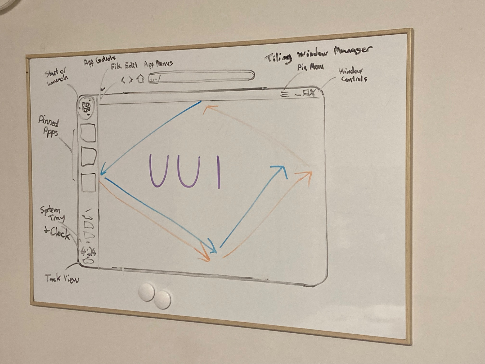
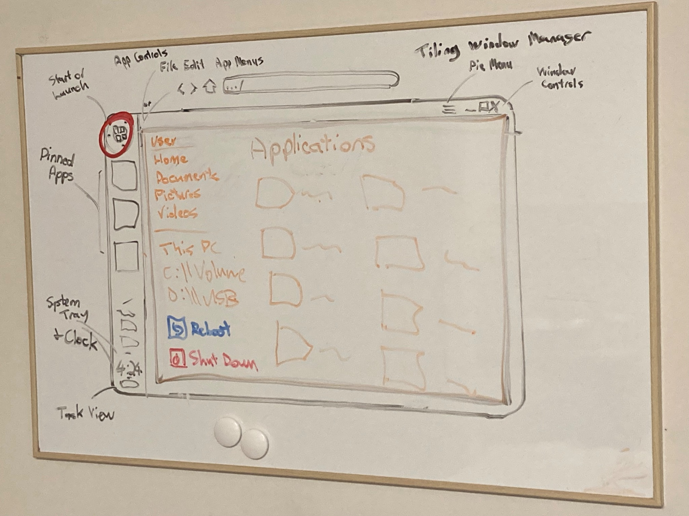
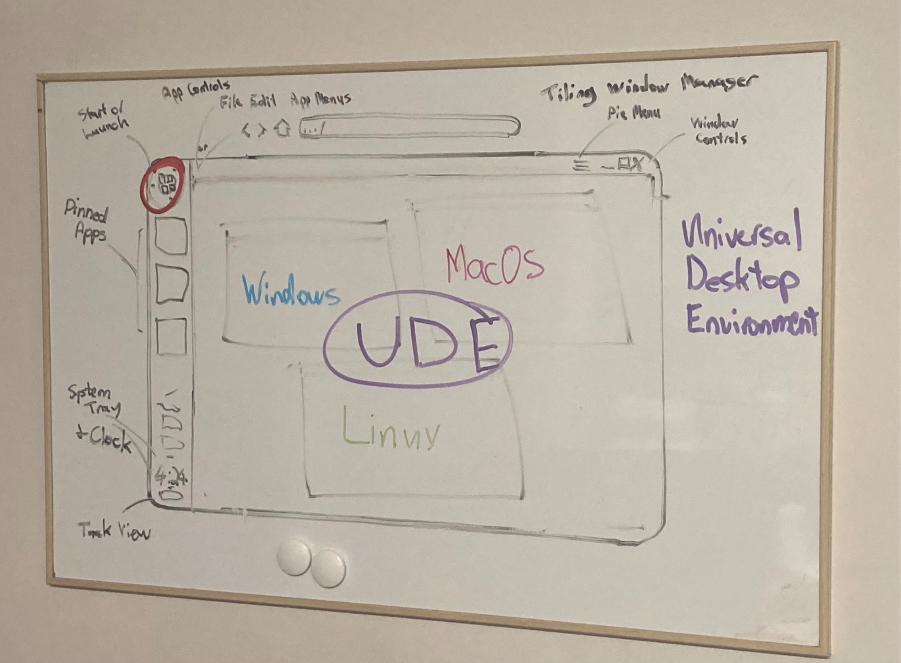
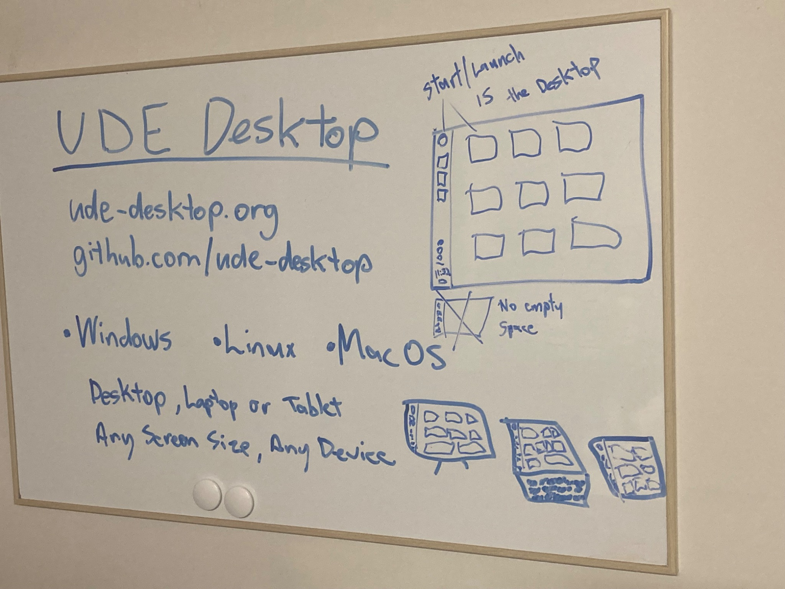
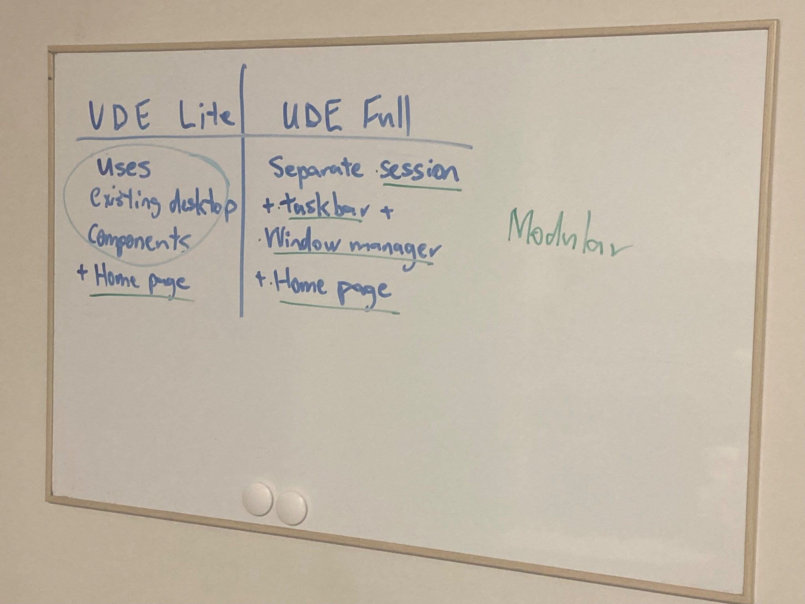
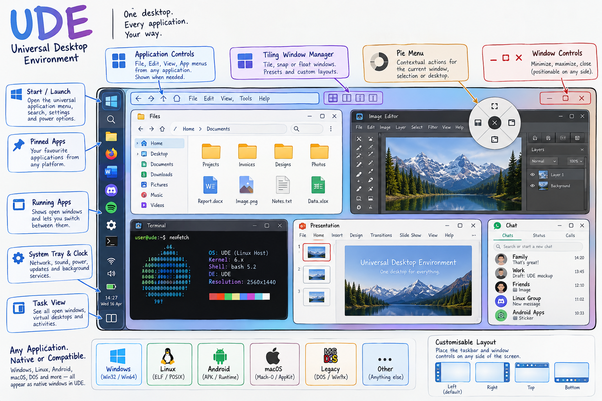

# UDE Desktop — Original Design & Vision

**Original whiteboard sketches are the primary design reference for UDE.** They show the intended behaviour and layout of the Universal Desktop Environment. The AI-generated illustration further down this page is an *interpretation*, not an implementation screenshot or a definitive specification.

> **One desktop. Every application. Your way.**

## Original whiteboard sketches

### 1. Universal desktop layout

The core desktop sketch: configurable side taskbar, start/launcher control, pinned apps, system tray and clock, task view, application menus, contextual pie menu, window controls and tiling window management. The coloured arrows explore window placement and tiling interactions.

### 2. Application launcher and file navigation

The start/launcher area opens an applications and navigation surface, with user folders, drives/devices, and restart/shutdown actions. This sketch explores the relationship between the launcher and the desktop, rather than prescribing a finished UI.

### 3. Cross-platform desktop concept

UDE aims for a consistent interface across Windows, Linux and macOS while taking advantage of each host's existing capabilities. Cross-platform application compatibility is an aspiration and should not be confused with a feature already implemented.

### 4. Desktop, laptop and tablet layouts

The launcher/home screen is also a desktop surface, with an emphasis on using available space rather than leaving an unnecessary empty area. Layouts should adapt to different screen sizes and input methods.

### 5. UDE Lite and UDE Full

**UDE Lite:** integrates with existing desktop components and adds the UDE home/launcher experience.

**UDE Full:** a separate desktop session with its own taskbar, window management and home/launcher experience.

The architecture should remain modular so features can be shared where practical.

## AI-generated concept illustration

*AI-generated visual interpretation based on the whiteboard ideas. Concept only — not an actual screenshot, a promise of supported operating systems, or evidence that illustrated compatibility features currently work. The original sketches above take precedence.*

## Notes for contributors

- Use the sketches as a guide to design intent, not as pixel-perfect specifications.
- Keep desktop components modular and adaptable to the host operating system.
- Distinguish **planned**, **experimental**, and **implemented** functionality in issues and documentation.
- Prefer native host functionality where possible; cross-OS executable compatibility requires separate engineering work.
- Propose design changes through issues or pull requests, referencing the relevant sketch.

## Project

[UDE Desktop repository](https://github.com/ude-desktop/ude-desktop)
